# 墨阅

[](https://github.com/Chenfyuan/novel-reader/actions/workflows/android.yml)

一款基于 Jetpack Compose 与 Material 3 的 Android 本地小说阅读器，支持 EPUB 与 TXT。

## 截图

| 书架（浅色） | 书架（深色） | 阅读页 | 阅读菜单 |
| :---: | :---: | :---: | :---: |
| 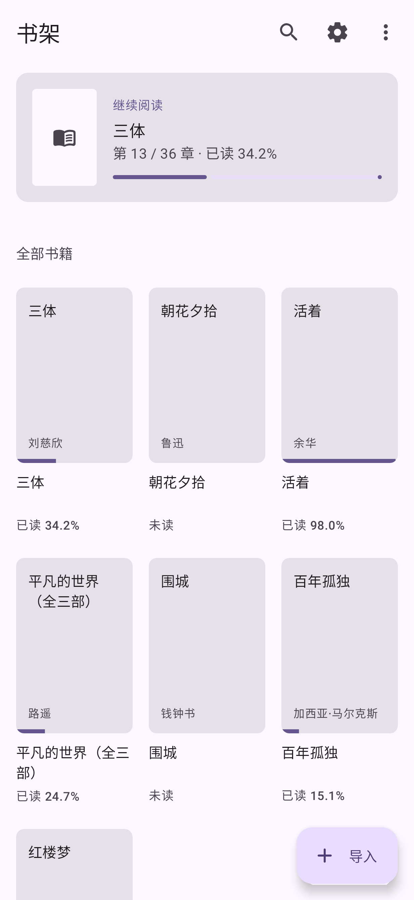 | 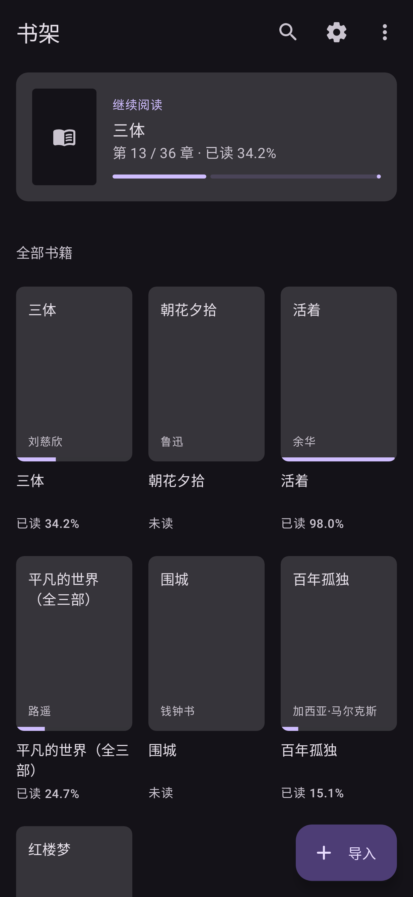 |  |  |

| 设置 | 竹青主题色 | 主题色设置 | 阅读统计 |
| :---: | :---: | :---: | :---: |
| 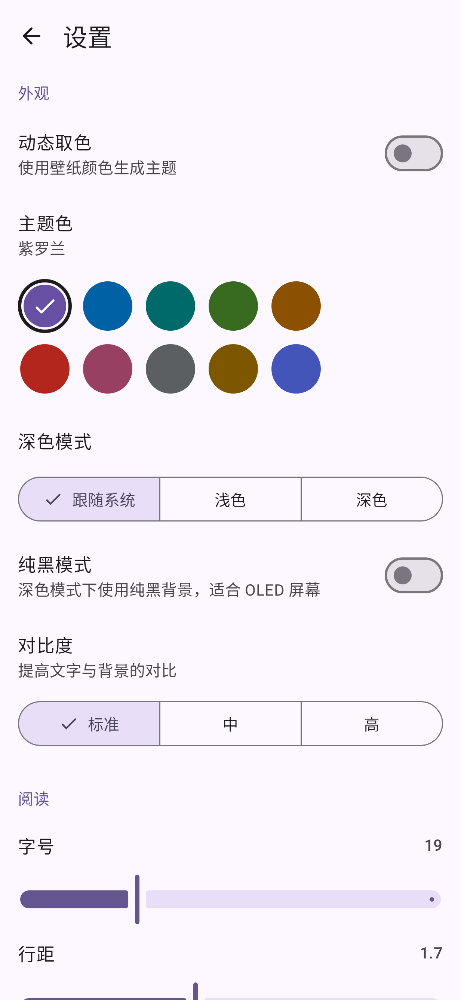 | 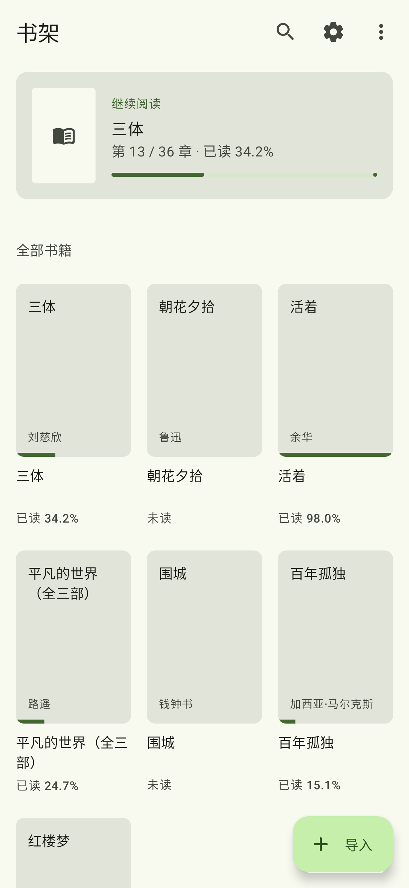 | 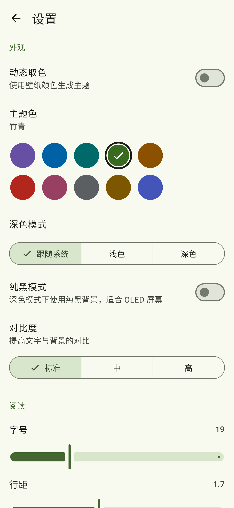 | 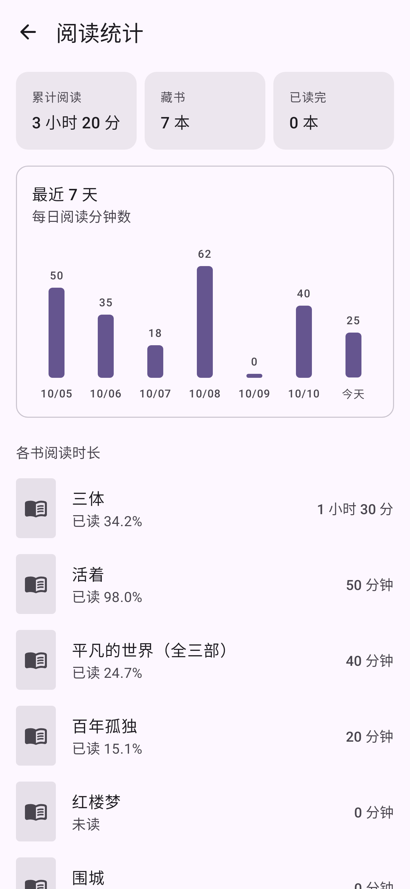 |

| 富文本 EPUB | 选中文字 | 划线与笔记 | 笔记列表 |
| :---: | :---: | :---: | :---: |
| 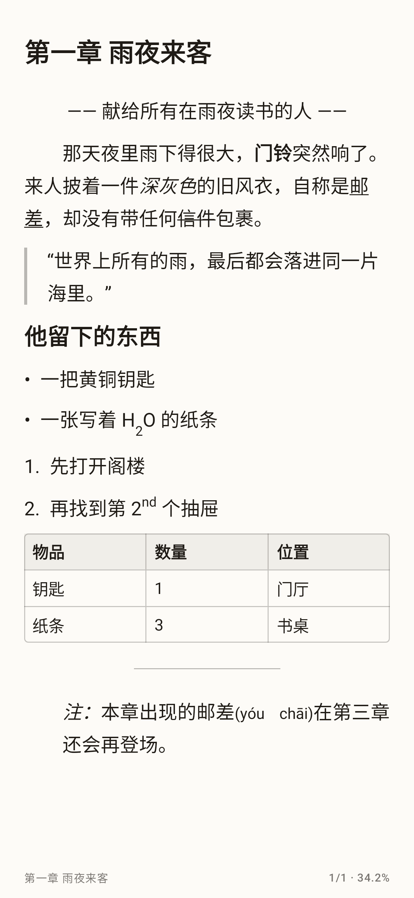 | 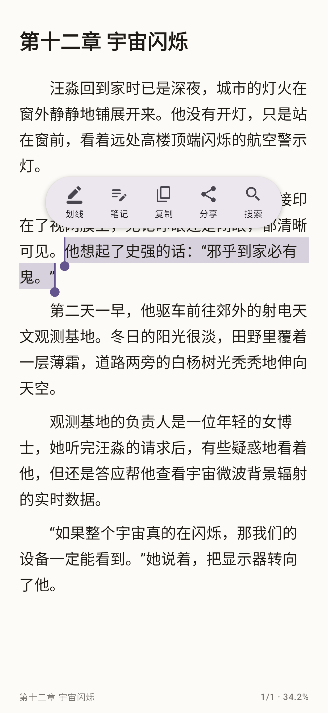 | 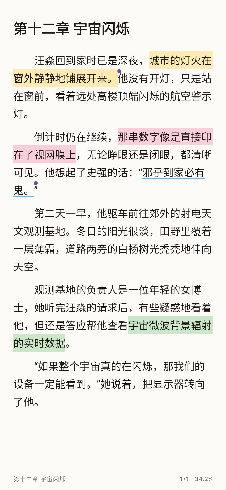 |  |

| 上下滚动 | 仿真翻页 | 分组与标签 | WebDAV 同步 |
| :---: | :---: | :---: | :---: |
| 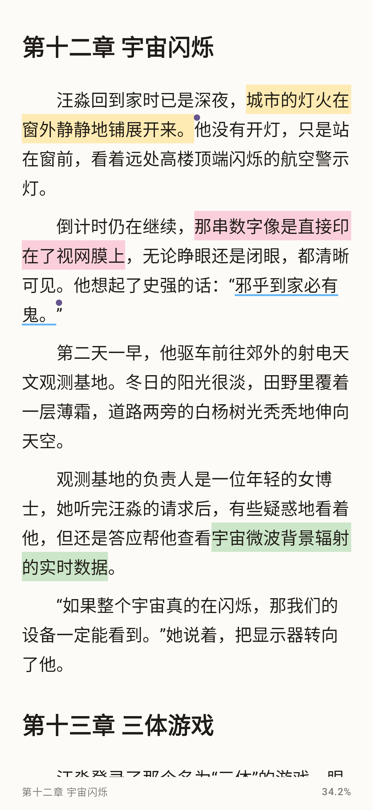 |  | 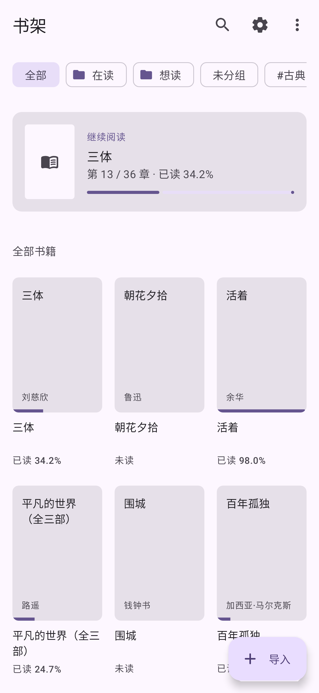 |  |

| PDF | 漫画（CBZ） |
| :---: | :---: |
| 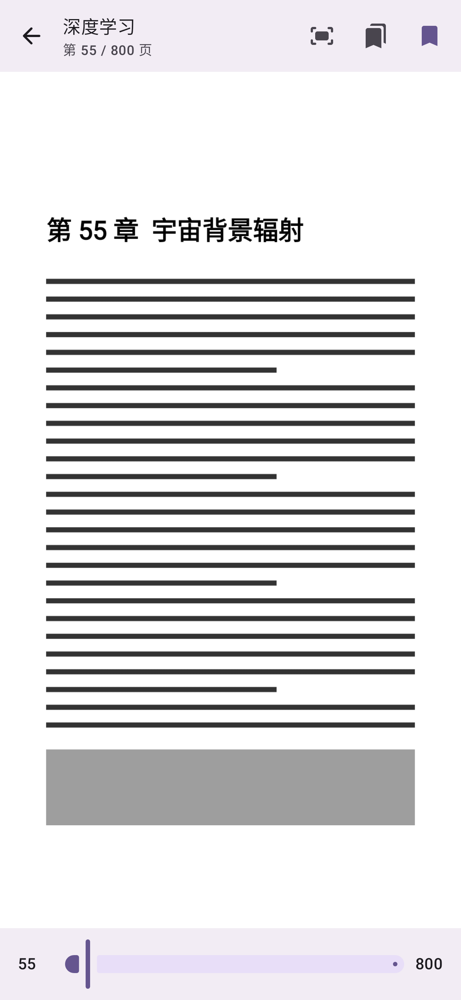 | 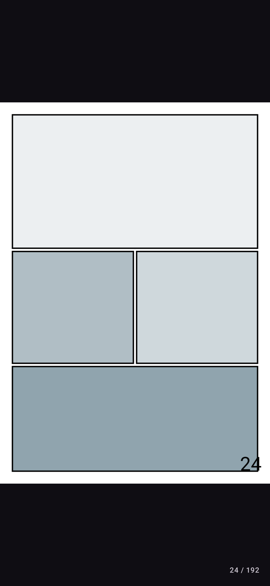 |

平板 / 折叠屏（1280×800dp）：

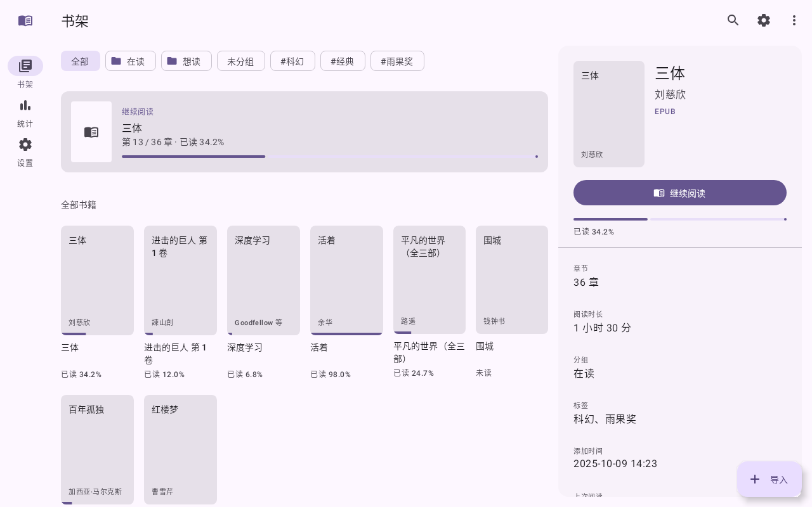

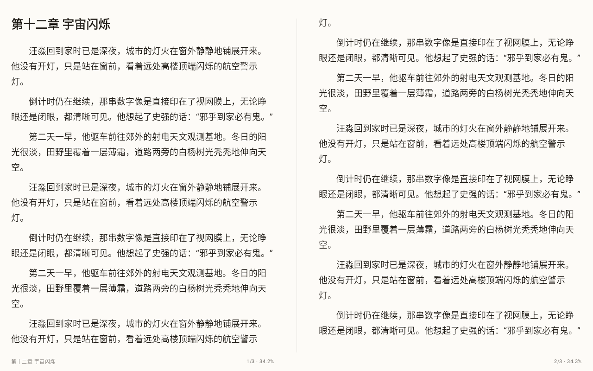

> 截图由 Roborazzi + Robolectric 截图测试生成，使用示例数据。

## 功能

### 阅读
- 按屏幕自动分页，左右滑动翻页，可跨章节
- 三种翻页动画：平移、3D 立方、层叠翻页
- 点按翻页（左右分区或全屏下一页），音量键翻页
- 字号、行距、段间距、页边距、首行缩进可调
- 四种阅读主题：明亮、羊皮纸、护眼、夜间
- 字体：系统默认、衬线，或导入 TTF/OTF 字体
- 繁体显示：基于 OpenCC 词库的词组级转换，可选繁体 / 台湾正体 / 香港繁体
- 仿真翻页：手指拖动页角卷起纸张，背面透出镜像文字并带折痕阴影，前后两个方向都可翻
- 上下滚动阅读模式：章节无缝衔接，支持划线、选区、朗读跟随与搜索跳转（设置或阅读菜单中切换）
- EPUB 链接可点按：内部链接跳到目标章节与锚点，外部链接确认后用浏览器打开
- 目录、书签（带章节与摘要）、全书搜索（关键词高亮）
- 划线与笔记：长按选中句子并拖动扩展选区；已有选区时翻页后在另一页长按，可把选区延伸过去（跨页选择），浮动工具栏提供划线（5 种颜色 + 下划线样式）、笔记、复制、分享、搜索；点按已有划线可改色、编辑笔记或删除；「笔记」标签页集中查看并跳转，可分享或导出为 Markdown
- 精确到字符的全书阅读进度，自动记住阅读位置
- 沉浸式全屏，可调亮度，屏幕常亮，页脚显示时间与电量

### 格式
- EPUB：解析 container.xml / OPF / spine，目录支持 EPUB3 nav 与 NCX，提取封面，正文内嵌图片按页宽显示
- EPUB 富文本：粗体、斜体、下划线、删除线、上下标、h1–h6 标题、引用块（左侧竖线）、有序 / 无序列表、分隔线、居中文本、链接样式、简单表格（列过多时退化为逐行文本）、ruby 注音（括号显示）
- 支持 EPUB CSS 安全子集：font-weight、font-style、text-decoration、text-align、text-indent、margin-left（tag / .class / tag.class 选择器与内联 style）
- 大文件：导入时流式解析一次并缓存每章内容与字数，打开时只读当前章，阅读中仅保留当前 ±1 章，分页在后台线程完成；书架显示导入进度
- TXT：自动识别 UTF-8 / UTF-16（BOM）/ GBK / GB18030；按「第X章/回/节/卷」等标题分章，无标题时按约 6000 字分块
- MOBI / AZW3（无 DRM）：纯 Kotlin 解析 PalmDB 记录与 PalmDOC 压缩，KF8 取 HTML 文本流，MOBI6 按分页标记分章，图片、封面、书名作者（EXTH）都会读取，之后与 EPUB 共用富文本排版
- PDF：系统 PdfRenderer 按页渲染，双指缩放 / 拖动、双击放大，适应宽度 / 适应屏幕，页码滑块、书签、进度保存
- CBZ / ZIP 漫画：压缩包内图片按自然顺序（page2 < page10）排列，与 PDF 共用看图阅读器，默认适应屏幕
- 受 DRM 保护的 EPUB / MOBI 与加密 PDF 会被拒绝并提示原因
- 通过系统文件选择器（SAF）导入，无需存储权限

### 听书
- 使用系统 TextToSpeech（简体中文），播放 / 暂停 / 停止
- 语速、音调可调，自动翻页翻章并高亮当前朗读段落
- 定时关闭（15–90 分钟）
- 基于 androidx.media3 MediaSessionService：系统媒体通知、锁屏控制、耳机 / 蓝牙按键（播放 / 暂停 / 上一章 / 下一章）
- 处理音频焦点（来电、其他应用播放时自动暂停并在恢复后继续）
- 朗读时跳过列表符号与装饰性符号，表格内容也会朗读

### 书架
- Room 数据库保存书籍、封面、进度
- 网格 / 列表视图，网格列数可设（自动 / 2 / 3 / 4）
- 按书名或作者搜索，按最近阅读 / 最近添加 / 书名排序
- 顶部「继续阅读」卡片，封面进度条
- 分组与标签：筛选条按分组 / 标签过滤；长按进入多选，批量移到分组、编辑标签、删除
- 阅读统计：累计时长、最近 7 天柱状图、各书阅读时长

### 平板与折叠屏
- 基于 WindowSizeClass：宽度 ≥ 840dp 时显示 NavigationRail（书架 / 统计 / 设置），书架变为列表-详情双栏，右侧显示书籍详情
- 横向宽屏或折叠屏「书本」姿态时正文双页并排；有铰链时两页的间隔对齐铰链宽度（Jetpack WindowManager）
- 折叠屏「桌面」姿态时正文只占上半屏
- PDF / 漫画在宽屏上也以双页显示

### 外观与主题
- 严格遵循 Material 3：配色角色、字体层级、圆角层级、4/8dp 间距
- 动态取色（Android 12+），或从 10 种预设主题色生成配色（支持标准 / 中 / 高对比度）
- 深色模式（跟随系统 / 浅色 / 深色），纯黑模式
- M3 动效：书架 → 阅读页容器变换、页面间共享轴、标签页淡入淡出、预测性返回手势
- Edge-to-edge，自适应图标（支持单色主题图标）

### 数据
- 备份到 JSON 文件：阅读进度、书签、划线与笔记、阅读统计、设置
- 从文件恢复（匹配书架上已有的书）
- WebDAV 同步（如坚果云、Nextcloud）：进度、书签、划线与笔记、阅读统计、设置按记录合并（最后修改者胜出，删除也会同步），可在打开应用和退出阅读时自动同步，可选上传书籍文件
- 清除缓存、恢复默认设置
- 设置使用 DataStore 持久化

## 技术栈

| 组件 | 版本 |
| --- | --- |
| Kotlin | 2.4.21 |
| Android Gradle Plugin | 9.4.1 |
| Gradle | 9.8.1 |
| Compose BOM | 2026.09.00 |
| Material 3 | 随 Compose BOM |
| Room（KSP 2.3.12） | 2.8.5 |
| DataStore Preferences | 1.2.1 |
| jsoup | 1.21.2 |
| MaterialKolor | 5.0.1 |
| Roborazzi / Robolectric（截图测试） | 1.76.0 / 4.17 |
| compileSdk / targetSdk | 37 |
| minSdk | 26（Android 8.0） |

## 构建

环境要求：JDK 21，Android SDK Platform 37 与 Build-Tools 37.0.0。

```bash
# 指定 SDK 位置（或在 local.properties 中写入 sdk.dir=...）
export ANDROID_HOME=/path/to/android-sdk

# 构建 Debug APK，产物位于 app/build/outputs/apk/debug/app-debug.apk
./gradlew assembleDebug

# 生成截图（Roborazzi），默认输出到 app/build/screenshots
./gradlew testDebugUnitTest -Proborazzi.test.record=true
```

## 持续集成

GitHub Actions（`.github/workflows/android.yml`）在推送到 main、Pull Request、手动触发以及推送 `v*` 标签时运行：

- 使用 JDK 21 与 Android SDK 37 构建 Debug APK，并运行单元 / 截图测试
- APK 上传为构建产物 `moyue-debug-apk`，截图上传为 `screenshots`
- 推送 `v*` 标签时自动创建或更新 GitHub Release 并附带 APK

## 项目结构

```
app/src/main/java/com/tavi/novelreader/
├── MainActivity.kt          # 入口、页面路由与转场、音量键
├── AppViewModel.kt          # 导入、进度、书签、搜索、备份恢复、清缓存、字体导入
├── data/
│   ├── Db.kt                # Room：书籍、书签、每日阅读时长
│   ├── Settings.kt          # 设置模型与 DataStore 仓库
│   └── Backup.kt            # JSON 备份 / 恢复
├── parser/
│   ├── Model.kt             # 章节 / 块 / 行内样式模型与纯文本映射
│   ├── Rich.kt              # XHTML → 样式块、CSS 子集解析
│   ├── Cache.kt             # 解析缓存、流式 TXT 导入
│   ├── BookStore.kt         # 构建 / 打开缓存、旧位置映射
│   └── Parsers.kt           # EPUB 结构解析、旧版 TXT 解析、繁体转换
├── tts/ReadAloud.kt         # 朗读控制器与前台服务
└── ui/
    ├── Theme.kt             # M3 主题、动态取色 / 种子色、动效令牌
    ├── Bookshelf.kt         # 书架
    ├── Reader.kt            # 阅读页、富文本排版、分页、选区、翻页动画、菜单
    ├── Notes.kt             # 选区工具栏、笔记编辑、笔记列表、Markdown 导出
    ├── SettingsScreen.kt    # 设置页、开源许可
    └── Stats.kt             # 阅读统计
app/src/test/.../ScreenshotTest.kt   # 截图测试
app/src/test/.../ParserTest.kt       # 解析 / 缓存 / 位置映射单元测试
app/src/test/.../BenchmarkTest.kt    # 50MB TXT 基准（-Pbench）
```

## 已知限制

- 尚未在真机或模拟器上进行完整测试，以上截图来自截图测试
- EPUB 样式只支持上面列出的子集；不支持浮动、字体、颜色、复杂选择器、内联 data: 图片和 SVG 图片
- 表格单元格单行显示（超长省略），行数超过一页时截断显示「共 N 行」；搜索命中表格时定位到表格开头
- 滚动模式下点按只用于呼出菜单（不按区域翻屏），翻屏使用手势或音量键
- 不支持 HUFF/CDIC 压缩的 MOBI（少数大型 Kindle 文件），KF8 内部链接（kindle:pos）不可跳转；KF8 章节按文件划分，未做骨架 / 片段重组，个别排版复杂的书段落顺序可能有偏差
- PDF 只能看图，不能选择文字、搜索或朗读；漫画不支持从右到左翻页
- 双页并排时使用平移翻页（仿真翻页仅单页）；铰链间隔假定铰链位于屏幕中央
- 平板与折叠屏只在截图测试中以 1280×800dp 渲染验证，没有在真实折叠屏上测试
- 1.3 及更早版本导入的书首次打开时会重建缓存，阅读位置 / 书签按全书比例映射到新结构，章内位置可能有少量偏移
- 听书依赖设备上的 TTS 引擎与中文语音包；媒体通知中没有进度条（TTS 无法预知时长）
- 繁体转换只采用转换前后长度相同的词条（保证位置一致），少数长度变化的地区用词不转换；搜索仍基于简体原文
- 备份不含书籍文件，恢复时按「书名 + 作者 + 格式」匹配已有书籍
- 使用动态取色时，对比度设置跟随系统
- 「层叠翻页」是旋转 + 阴影的近似效果；「仿真翻页」是平面折叠（直线折痕 + 阴影），不是带弧度的三维卷曲，也不能跨章节连续卷页（翻到章末会切换章节）
- 同步只覆盖阅读数据和设置，不同步分组与标签；不会从服务器下载书籍文件到新设备（需要先在新设备导入同一本书）；未做 Google Drive 同步
- 同一记录在两台设备上都修改时，较早的修改会被覆盖（按记录而非字段合并），依赖各设备时钟大致准确

## 更新日志

### v1.7
- 新格式：MOBI / AZW3（无 DRM）、PDF、CBZ / ZIP 漫画；DRM 文件给出明确提示
- 平板 / 折叠屏：NavigationRail、列表-详情书架、双页并排、铰链感知

### v1.6
- 仿真翻页（Canvas 绘制的卷页效果）
- 书架分组与标签：新建 / 重命名 / 删除分组，筛选条，长按多选后批量移动、加标签、删除
- WebDAV 同步：进度、书签、划线与笔记、阅读统计、设置逐条按最后修改时间合并，支持自动同步和上传书籍文件；密码用 Android Keystore 加密保存

### v1.5
- OpenCC 词组级繁体转换（繁体 / 台湾 / 香港）
- 上下滚动阅读模式
- 听书升级为 media3 MediaSession：媒体通知、锁屏与耳机控制、音频焦点、跳过装饰符号
- EPUB 链接跳转、跨页选择、表格文字可搜索与朗读

### v1.4
- EPUB 富文本排版与 CSS 子集解析
- 大文件性能：流式导入 + 分章缓存 + 懒加载 + 后台分页，书架显示导入进度；旧书首次打开时自动迁移
- 划线与笔记：选中工具栏、5 种颜色 + 下划线、笔记编辑、「笔记」标签页、Markdown 导出；纳入备份恢复
- 数据库升级到 v3（新增 highlights 表与缓存版本字段），原有进度与书签保留

### v1.3
- 设置页、动态取色与主题色、字体导入、繁体显示、定时关闭、备份恢复

### v1.2
- Material 3 设计规范全面打磨

### v1.1
- 书签、全书搜索、听书、EPUB 图片、阅读统计

## 许可证

本项目基于 [MIT License](LICENSE) 开源。
